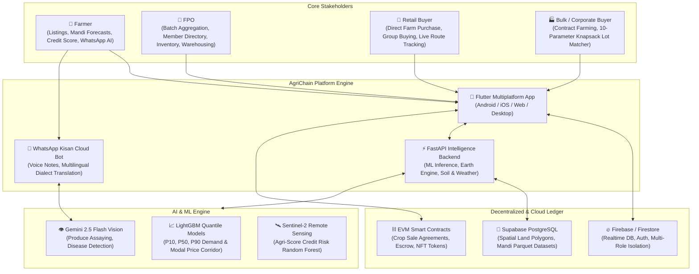

# 🌱 AgriChain

> **Decentralized Agricultural Supply Chain, AI-Powered Contract Farming & Credit Intelligence Platform**

[](https://flutter.dev)
[](https://dart.dev)
[](https://soliditylang.org/)
[](https://fastapi.tiangolo.com/)
[](https://firebase.google.com/)
[](https://ai.google.dev/)
[](LICENSE)

---

## 📌 Executive Overview

**AgriChain** transforms fragmented rural agricultural markets into a transparent, decentralized, and verifiable digital ecosystem. By uniting **cross-platform mobile applications (Flutter)**, **EVM smart contracts (Solidity)**, **satellite earth observation (Sentinel-2 NDVI)**, and **multimodal AI (Gemini 2.5 Flash Vision & LightGBM probabilistic forecasting)**, AgriChain solves three fundamental bottlenecks in Indian agriculture:

1. **Elimination of Predatory Intermediaries:** Direct peer-to-peer and bulk contracting between Farmers, FPOs (Farmer Producer Organizations), and Buyers.
2. **AI-Driven Quality Assurance:** Instant on-device and cloud multimodal vision assaying to grade crops (AGMARK standards), detect rot/spoilage, and assess purity before marketplace listing.
3. **Alternative Credit Underwriting:** Satellite remote sensing combined with machine learning models to generate fair, verifiable credit scores (**Agri-Score**) for unbanked smallholders.

---

## 🏛️ Ecosystem Architecture & Roles

AgriChain is architected around four distinct participant personas and two automated intelligence layers:



### 1. 🌾 Farmer
- **Smart Crop Listing:** Instant produce scanning using **Gemini 2.5 Flash Vision** to determine AGMARK grade, moisture %, defect %, and reject rotten/spoiled crops under 50% purity.
- **Mandi Demand Forecasting:** 3-tier probabilistic price and demand forecast curves ($P_{10}$ conservative, $P_{50}$ median, $P_{90}$ upside).
- **DigiLocker Integration:** One-click verified identity and land registry onboarding without paperwork.
- **Satellite Land Analysis:** Real-time Sentinel-2 NDVI vegetative health graphs and micro-loan credit ratings.
- **WhatsApp Kisan AI Assistant:** Voice-note driven trade intent extraction and disease remedies in regional dialects (Hindi, Punjabi, Marathi, Haryanvi).

### 2. 🏢 FPO (Farmer Producer Organization)
- **Member Directory & Governance:** Member KYC, landholdings, active crop inventory, and financial ledger.
- **Spatial Pooling & Cluster Routing:** Aggregation of smallholder batches within $\le 7\text{ km}$ radii for dispatch.
- **B2B Bulk Fulfillment:** Connecting collective farmer yield directly to corporate buyers.

### 3. 🛒 Retail Buyer
- **Direct Farm Sourcing:** Fresh produce purchases direct from local farmers with verified quality tags.
- **Group Buying / Community Pooling:** Cluster discounts and collective logistics to lower shipping overhead.
- **Live Dispatch Simulation:** End-to-end GPS and multi-stage transit tracking from farm harvest to doorstep.

### 4. 🏭 Bulk / Institutional Buyer
- **Contract Farming Agreements:** Legally binding, automated contracts with escrow guarantees.
- **10-Parameter Combinatorial Matching Engine:** Dynamic knapsack optimization to fulfill large corporate demands from dozens of fragmented smallholder plots.

---

## 🧠 Master Machine Learning & AI Suite

AgriChain includes **14 specialized ML/DL models** and **2 spatial combinatorial engines**:

| # | Model / Service | Category | Algorithm / Architecture | Key Purpose |
|---|---|---|---|---|
| 1 | **Gemini Produce Assayer** | Multimodal Vision | Google Gemini 2.5 Flash Multimodal | AGMARK grading, purity scoring, fungal rot & necrosis rejection |
| 2 | **WhatsApp Vision Assayer** | Multimodal Vision | Google Gemini 2.5 Flash Vision | On-the-field WhatsApp photo inspection & disease advisory |
| 3 | **Offline Chrominance Assayer** | Computer Vision | HSV/RGB Color Spectrum & Entropy | On-device offline fallback filtering for non-crop images |
| 4–6 | **$P_{10}, P_{50}, P_{90}$ Demand Models** | Quantile Forecasting | LightGBM Quantile Regressors | 10th, 50th, and 90th percentile mandi demand volume forecasting |
| 7 | **Modal Price Regressor** | Time-Series Forecasting | LightGBM Regressor (RMSE Objective) | Corridor clearing price prediction (₹/kg) across state mandis |
| 8 | **Volatility Spread Models** | Risk & Volatility | Dual LightGBM Spread Estimators | Minimum and maximum price volatility boundaries |
| 9 | **Agri Trust Credit Scorer** | Financial Underwriting | Scikit-Learn `RandomForestRegressor` | 0–100 creditworthiness score from satellite NDVI & land data |
| 10 | **Crop Quality Classifier** | Agronomic Classification | Scikit-Learn `RandomForestClassifier` | Yield quality categorization (`Excellent`, `Good`, `Moderate`, `Poor`) |
| 11 | **Risk Level Classifier** | Credit Risk Assessment | Scikit-Learn `RandomForestClassifier` | Default probability classification (`Low`, `Medium`, `High`) for loans |
| 12 | **15-Day NDVI Trend Classifier** | Remote Sensing ML | Scikit-Learn `RandomForestClassifier` | 15-day satellite vegetation health trajectory forecasting |
| 13 | **Dialect Speech-to-Intent** | Speech & Audio AI | Google Gemini 2.5 Flash Audio | Regional audio dialect parsing & structured order generation |
| 14 | **Multilingual Agronomic NLP** | Conversational AI | Gemini 2.5 Context Pipeline | End-to-end conversational agronomic advice and advisory |
| 15 | **Demand Knapsack Matcher** | Optimization Engine | Multi-Objective Lot Aggregation | Optimal grouping of smallholder lots to fulfill bulk purchase orders |
| 16 | **Spatial Cluster Optimizer** | Graph Theory & TSP | Radius-Constrained Spatial Clustering | Groups farmer harvests within $\le 7\text{ km}$ corridors with route optimization |

> 📖 **Deep Technical Specification:** For full mathematical formulations, hyperparameters, feature engineering pipelines, and evaluation metrics, see [ML_MODELS_DOCUMENTATION.md](file:///c:/Users/adity/Downloads/New%20folder%20(10)/agrichain/ML_MODELS_DOCUMENTATION.md).

---

## ⛓️ Smart Contracts & Blockchain Layer

The platform includes EVM-compatible Solidity smart contracts designed for deployment on Ethereum, Polygon, or local testnets:

* **`1_Storage.sol`**: Decentralized immutable record storage for harvest certifications and provenance logs.
* **`2_Owner.sol`**: Access-control and multi-signature authorization contract for administrative operations.
* **`3_Ballot.sol`**: FPO cooperative voting governance for crop pricing policies and collective decisions.
* **Smart Escrow & Crop Sale Agreements**: Programmable escrow smart contracts that hold buyer payments until produce quality is verified at delivery.
* **Digital Loan Agreements**: Micro-lending agreements tied to the farmer's on-chain credit history.

---

## 📂 Repository Structure

```
agrichain/
├── docs/                                          # Architecture specifications & user flow diagrams
│   ├── agrichain-user-flow.html                   # Interactive standalone user flow visualization
│   ├── AGRICHAIN_ML_MODELS_SPECIFICATION.md       # Full ML specification and model architectures
│   └── AGRICHAIN_USER_PROFILES_AND_SCREENS_...    # Complete UI/UX screen breakdown
├── ML_MODELS_DOCUMENTATION.md                     # Deep-dive ML model documentation
├── geetauni-main/                                 # Primary application source
│   ├── agrichain/                                 # Flutter mobile & web application
│   │   ├── lib/
│   │   │   ├── config/                            # Environment & Firebase initialization
│   │   │   ├── models/                            # Firestore & data models
│   │   │   ├── providers/                         # Riverpod & AppState management
│   │   │   ├── screens/                           # Screens for Farmer, FPO, Retail, Bulk
│   │   │   ├── services/                          # Gemini Vision, Live Translation, DB services
│   │   │   └── widgets/                           # Reusable UI widgets & translated components
│   │   └── pubspec.yaml                           # Flutter dependencies
│   ├── contracts/                                 # Solidity smart contracts
│   ├── scripts/                                   # Ethers.js & Web3.js deployment scripts
│   └── whatsapp_cloud_api/                        # WhatsApp Cloud API multi-role bot server
└── score/                                         # Intelligence & scoring backend
    ├── agri_score/                                # Credit assessment Flutter web frontend
    ├── no/                                        # FastAPI Python intelligence service
    │   ├── ml/                                    # Trained .joblib models & training pipelines
    │   ├── integrations/                          # Earth Engine, Soil, Weather & Mandi APIs
    │   └── routers/                               # Prediction, forecast & analysis endpoints
    └── supabase/                                  # Database migrations and SQL schemas
```

---

## 🚀 Quickstart Guide

### 1. Prerequisites
- **Flutter SDK** (`>= 3.3.0`)
- **Dart SDK** (`>= 3.0.0`)
- **Python** (`3.10` or higher)
- **Node.js LTS** (`>= 18.x`)
- **Google Cloud / Firebase Project** (for Firestore and Gemini API keys)

---

### 2. Setting Up the Flutter Application

```bash
# Navigate to the Flutter app directory
cd geetauni-main/agrichain

# Install Flutter dependencies
flutter pub get

# Run on Chrome (Web)
flutter run -d chrome

# Run on an Android Device / Emulator
flutter run -d android
```

---

### 3. Setting Up the FastAPI Intelligence Backend

```bash
# Navigate to the Python backend directory
cd score/no

# Create and activate a virtual environment
python -m venv venv
# Windows:
.\venv\Scripts\activate
# Linux / macOS:
source venv/bin/activate

# Install required machine learning dependencies
pip install -r requirements.txt

# Start the FastAPI server with hot-reload
uvicorn main:app --host 0.0.0.0 --port 8000 --reload
```

---

### 4. Compiling & Deploying Smart Contracts

The smart contracts are Remix-ready and compatible with Hardhat / Foundry:

```bash
# Navigate to the root of the workspace
cd geetauni-main

# Install development dependencies
npm install

# Deploy contracts via ethers.js script
npx ts-node scripts/deploy_with_ethers.ts
```

---

## 🔒 Security & Privacy Practices

* **Zero Plaintext Secrets:** Sensitive API keys, Firebase service account keys, and private credentials are excluded via `.gitignore`.
* **DigiLocker Sandbox:** Adheres to MeitY (Ministry of Electronics and Information Technology) guidelines for non-custodial e-KYC verification.
* **Role-Based Access Control (RBAC):** Strict Firestore security rules ensure data isolation between Farmers, FPOs, and Retail/Bulk buyers.

---

## 📄 License

This project is licensed under the [MIT License](LICENSE).
